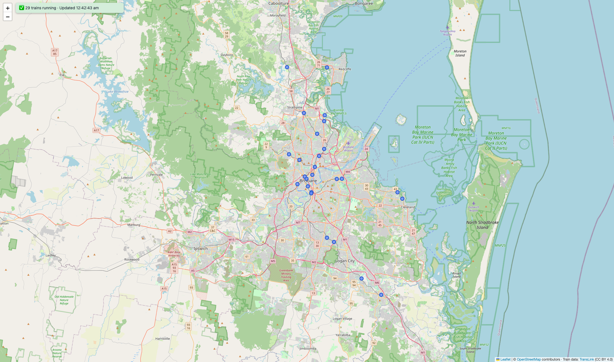

# Railway Live 🚆

A live map of Brisbane trains. A small Express server reads TransLink's real-time GTFS-RT feed, caches it for 30 seconds, and serves it as JSON to a Leaflet map that refreshes itself.

📁 **[GitHub Repo](https://github.com/vy-trg/railway-live)**

<!-- Add after deploying: 🔗 **[Live Demo](https://YOUR-APP.onrender.com)** -->
<!-- Add after taking a screenshot (save it as docs/screenshot.png):
<p align="center"></p>
-->

---

## About

TransLink publishes where every train is, but in Protocol Buffers (a binary format), not JSON, and the feed only changes about every 30 seconds. If every browser fetched it directly, each visitor would hit TransLink separately and the browser would have to decode protobuf itself.

Railway Live puts a thin server in between: it fetches and decodes the feed **at most once every 30 seconds**, however many people have the map open, and hands the browser a small, clean JSON list.

**My role:** Solo project. I built the GTFS-RT ingestion and cache on the server, the `/api/trains` endpoint, and the Leaflet map with its status banner.

---

## Features

- **Live train positions** for the South East Queensland rail network, refreshed every 30 seconds without reloading the page.
- **Server-side cache:** the feed is fetched at most once per 30 seconds; requests that arrive while a fetch is running wait for that same fetch.
- **Keeps working when the feed fails:** the map keeps the last known positions and a yellow banner says the data may be old. If there is no data at all, the API returns `503` and the banner turns red.
- **Markers move instead of multiplying:** each train keeps one marker that is moved with `setLatLng`; trains that leave the feed are removed.
- **Mobile friendly:** full-screen map, refreshes as soon as you come back to the tab on a phone.

---

## Tech Stack

| Area | Tools |
|---|---|
| Server | Node.js 22+, Express 5 |
| Data | TransLink GTFS-RT, decoded with `gtfs-realtime-bindings` |
| Frontend | HTML, CSS, vanilla JavaScript |
| Map | Leaflet 1.9, OpenStreetMap tiles |

---

## How it works

```
Browser (Leaflet map)  --every 30s-->  GET /api/trains  -->  30s in-memory cache  -->  TransLink GTFS-RT feed
```

1. **Same origin:** Express serves `public/index.html` and the API from one server, so the browser needs no CORS setup.
2. **In-memory cache:** the decoded feed is kept in a variable with the time it was fetched. Requests within 30 seconds get the cached copy.
3. **Timeout:** a TransLink request that takes longer than 10 seconds is cancelled, so a slow feed can't hang the API.

### API

| Method | Path | Returns |
|---|---|---|
| `GET` | `/api/trains` | `{ updatedAt, stale, trains: [{ id, tripId, lat, lng }] }`. `stale: true` means the feed failed and these are the last known positions. `503` if no data is available yet. |
| `GET` | `/api/health` | `{ ok: true }` |

---

## Run it locally

**Needs:** Node.js 22 or newer (`node -v` to check). No API key is required.

```bash
git clone https://github.com/vy-trg/railway-live.git
cd railway-live
npm install
npm run dev
```

Open http://localhost:3000. Trains only appear while Queensland Rail services are running.

**Try the error handling:** run `FEED_URL=http://localhost:9999 npm run dev` (an address with nothing on it). The API returns `503` and the map shows a red banner instead of breaking.

---

## Project structure

```
server.js          Express server: fetch, decode, cache, /api/trains
public/index.html  Leaflet map, markers and status banner
learning/          Practice files from building this (first feed script, first Leaflet map)
NOTES.md           Notes on the data source and what I learned
```

---

## What I learned

- GTFS-RT is protobuf, not JSON; `FeedMessage.decode` turns the bytes into JavaScript objects.
- The difference between **VehiclePositions** (where each train is now) and **TripUpdates** (delays and arrival times).
- Caching on the server protects both the upstream API and response time, and a cache also gives you something to show when the upstream fails.
- Updating existing Leaflet markers instead of redrawing them avoids flicker and duplicate markers.

---

## Data & licence

Train data: [TransLink GTFS-RT](https://translink.com.au/about-translink/open-data), licensed under [CC BY 4.0](https://creativecommons.org/licenses/by/4.0/).
Map tiles: © [OpenStreetMap](https://www.openstreetmap.org/copyright) contributors.
