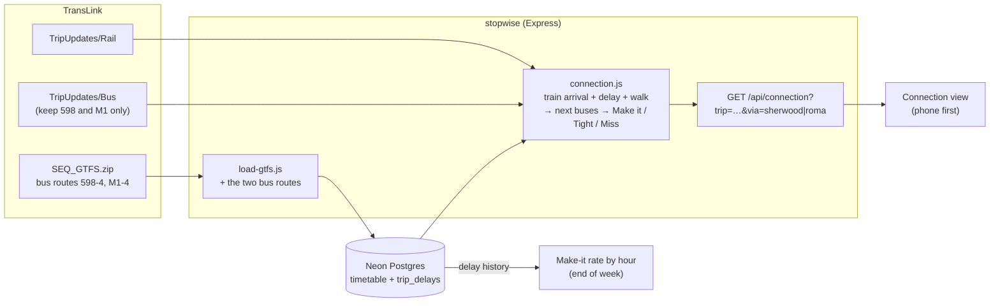

# Train + bus: will I make the connection?

## The problem

I take the Springfield line, then a bus to Griffith's Nathan campus. If the train is a few minutes late, I miss the bus and wait for the next one. TransLink shows where each train and bus is, but not the question I actually have: *will I make this connection?*

This feature answers it for one trip: given a train (with its live delay), the change point, and the walk, which bus can I catch, and is it **Make it / Tight / Miss**? Later it suggests the most reliable train + bus for a time I need to be at Nathan, using the delay history Stopwise already records.

## Where to change (from the timetable, 8 Nov)

| Change at | Bus | From stop (distance from station) | To | Bus time | Runs |
|---|---|---|---|---|---|
| **Sherwood** | **598** Great Circle Line (anti-clockwise), `route_id 598-4` | Sherwood Rd near Hedges St, `5341` (~110 m) | Troughton Rd at QEII Hospital, `10306` (edge of Nathan campus) | ~23 min | about every 30 min, 6:00 am – 6:15 pm |
| **Roma Street** | **M1** Brisbane Metro, Eight Mile Plains – City, `route_id M1-4` | Roma Street busway, platform 2, `10792` (~40 m from the station entrance) | Griffith University station, platform 2, `10819` | ~19 min | every few minutes, 5 am – after midnight |

Station ids: Sherwood `place_shesta` (platforms `600309`–`600312`), Roma Street `place_romsta` (platforms `600028`–`600038`).

Nothing else on the Springfield line has a direct bus to Nathan within 500 m. Central station has many more routes, but trains reach Roma Street first, so Roma Street is the better change.

Note: 598 and M1 are both buses in the GTFS feed (`route_type 3`), so they come from `TripUpdates/Bus`, which is a much bigger feed than Rail. We keep only these two routes.

## Walking time to change

Straight-line distances from the timetable, plus stairs and crossings. **These are my own estimates from doing the walk; update after timing it.**

| Change | Walk | Estimate |
|---|---|---|
| Sherwood: platform → Sherwood Rd stop 5341 | ~110 m, stairs and a road crossing | 3 min |
| Roma Street: platform → busway platform 2 | ~150 m inside the station, stairs | 4 min |

## Architecture



## Rules (to test)

- Arrival at the change = scheduled arrival + the train's current delay.
- Ready for the bus = arrival + walk.
- **Make it**: the bus leaves 3 minutes or more after you're ready. **Tight**: 0–3 minutes. **Miss**: it leaves before you're ready, and the next bus is shown instead.
- Bus departure uses the bus's own live delay when there is one.

## Plan

| Day | What |
|---|---|
| Mon 9 Nov | This page: problem, change points, route ids, walking estimates, diagram |
| Tue 10 Nov | ~~Load 598 and M1 timetables~~ Done early in PR #14: every SEQ bus is loaded (598: 292 trips, M1: 1,292 trips; whole database 64 MB with trip patterns). Brought Wednesday's `connection.js` forward instead |
| Wed 11 Nov | ~~`connection.js`~~ done on Tue (13 tests). Wednesday: `GET /api/connection?trip=…&via=sherwood\|roma` (Thursday's item, brought forward): train's live arrival + walk, then the 598 or M1 departures from the change stop with their live delays; returns Make it / Tight / Miss, the bus to catch and the one after |
| Thu 12 Nov | Live bus delays from TripUpdates/Bus (two routes only); `GET /api/connection` |
| Fri 13 Nov | Connection view on the phone |
| Sat 14 Nov | Make-it rate by hour from the recorded delays |
| Sun 15 Nov | "Be at Nathan by…" suggestion; README; demo |

## API

`GET /api/connection?trip=<train trip id>&via=sherwood|roma`

```json
{
  "via": "Sherwood", "route": "598",
  "train": { "arrives": "7:22 am", "scheduled": "7:22 am", "delaySecs": null, "platform": "2" },
  "walkMins": 3, "ready": "7:25 am",
  "verdict": "make",
  "catch": { "leaves": "8:22 am", "spareMins": 57, "status": "make", "live": false },
  "next": null, "waitMins": 57, "busLive": false
}
```

- `verdict` is about the bus you were aiming for (the first one after the train is due on time); `catch` is the one you'll actually get.
- `live: false` on a bus means TransLink has no prediction for it yet (it hasn't started its trip), so its time is the timetable.
- Limit: the train trip is assumed to run today (Brisbane date). A trip id from another day gives that day's times on today's date.

## On the page (day 4)

Open any train that still has Sherwood or Roma Street ahead (Live or Departures). Under the title: **Catching a bus after this train?** with *598 at Sherwood* and *M1 at Roma Street*. Pick one: **Make it / Tight / Likely to miss it / No more buses**, in words and colour, the train's arrival (and how late), the walk, the bus to catch with minutes to spare, and the one after. It refreshes with the trip every 30 seconds.

Fix found while building it: Roma Street's M1 platform (10792) belongs to the busway station (place_rompl), so looking it up as a station found nothing. The API now asks for the station of the stop and keeps only that platform.

## Any bus, any station (13 Nov, after Vy's feedback)

Vy's question: Roma Street busway has dozens of routes going past; why only ask about the M1? Changed to:

- **Any station** on the train with a bus stop within **450 m** can be picked ("Change at"). The walk to each stop is estimated: 90 s to get off the platform, plus about a second a metre (straight line stretched by a quarter, walked at 4.5 km/h), rounded up to whole minutes.
- **Every bus** leaving those stops from 5 minutes before the train gets in to 40 minutes after, each marked Make it / Tight / Miss **for the walk to its own stop**. A bus calling at two nearby stops is shown once, at the stop where you can catch it. Only the last two misses before the first catchable bus are shown.
- **Going to** (optional): any station, stop or place (campus, airport) from the search list. Only buses that go there are shown, each with when it gets there; the stop is marked *get off* in its stops. Nothing here is specific to one person's trip. Plus a box for a bus number.
- **Tap a bus**: live delay (or "timetable time"), where it leaves from, the walk, and every stop from there on with times.
- **Follow this bus**: it stays at the top of the list and is re-checked every 30 seconds with the train. If the train (or the bus) changes so it becomes a miss, a warning says so and gives the next bus on the same route. Remembered in this browser only.

API:
- `GET /api/connection/places?trip=<train trip id>`: stations on the trip with a bus stop nearby.
- `GET /api/connection?trip=<train trip id>&at=<station id>[&to=<station, stop or landmark id>]`: `{ station, to, train: { arrives, scheduled, delaySecs, platform }, buses: [{ tripId, route, headsign, stop, platform, walkMins, scheduled, leaves, delaySecs, live, spareMins, status, arrives, offSequence, walkOnStreets, planAt }], busLive }`. Replaces `via=sherwood|roma`.

Walks (updated the same day): measured along real streets for every station alike (no personal timings: the app is for everyone) by the walking router (OSRM, OpenStreetMap), plus 90 s to get off the platform, since the router doesn't know stairs or how long the lights take. A stop it can't route to keeps the straight-line estimate and shows "~" in front of the walk.

**Plan this trip** (in a bus's details): opens the Plan tab from the change station, leaving in time for that bus, to where you said you're going (otherwise where the bus ends). The planner may find something better than that bus.

Bus delays: checked against TransLink's live bus feed on 13 Nov, 9:35 am: 1,754 trips in the feed, 930 of them not started yet, and 827 of those already had a predicted delay of a minute or more (the delay carried over from the bus's previous trip). So buses do get delays before they start; a bus with no prediction at all shows its timetable time.

## How often would I make it? (Stats tab, 14 Nov)

"Making a connection" on the Stats tab: pick how many minutes you leave to change (3, 5 or 10) and a line (or all train lines). For each hour of the day, the share of trips that would have got you there in time: a trip counts when it ran less late than the minutes you left; a cancelled trip never does. Hours with fewer than 5 trips are left out. From `trip_delays` (recorded every 10 minutes since 31 Oct).

Limit: `trip_delays` keeps how late a trip was at the **end of its run**, not at each station, so that stands in for how late it is where you change (said under the chart). For the stations in the middle of a line it can over-state the delay a little.
