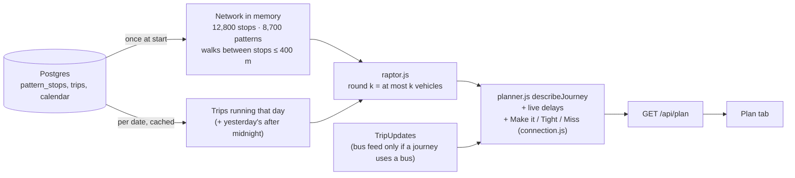

# Journey planner (Plan tab)

## The problem

The Live tab's "Where to?" only shows vehicles running now that go straight to a place. It can't answer the real question: *from where I am, which train, bus, tram or ferry do I take, where do I change, and when do I get there?*

## How it works

**RAPTOR** (Delling, Pajor, Werneck, Microsoft Research, 2012) works in rounds. Round 1 finds every stop you can reach with one vehicle, round 2 with one change, and so on. Each round only looks at routes that stop somewhere that improved in the round before, so it's fast without building a graph of every stop time. The trip patterns that keep the database small (see README) are exactly RAPTOR's "routes": trips with the same stops and gaps, so trips of a pattern never overtake each other and the first trip you can catch is a binary search.

To give several options, the planner runs again leaving a minute after the first vehicle of the fastest option, until it has 5 different journeys.

## Measured (local, full SEQ timetable)

| | |
|---|---|
| Load network | ~0.6 s, once at start |
| Load one day's trips | ~0.1 s, then cached (3 days kept) |
| One plan (5 journeys) | 0.15–0.4 s |
| Memory | ~125 MB heap |

## Rules

| Rule | Value | Why |
|---|---|---|
| Change at the same stop | 1 min | Time to get off and on |
| Platforms of the same station | 2 min | Stairs, crossing the station |
| Walk between nearby stops | up to 400 m, 4.5 km/h, +20% for streets, at least 2 min | Straight lines are shorter than real paths |
| "Near me" and walking at the end | stops within 800 m | About 10 minutes' walk |
| Changes | up to 4 (5 vehicles) | More is rarely useful |
| Give me more time to change (switch) | at least 5 mins at every change, on top of the walk | Fewer tight changes; may arrive a little later |
| Make it / Tight / Miss | `connection.js`: 3+ min spare / 0–3 / less | Same rule as the train + bus feature |

## On the map

When a journey is shown, the rest of the map fades to a quarter and the journey is drawn on its own layer on top: a thick line in the route's colour with a dark outline, the stops along it, and labels where you get on, change and get off. Walks are dark dotted lines.

## Places by name

Typing "griffith" shows every Griffith campus first (Nathan, Mt Gravatt, Gold Coast, Logan, South Bank), like a map search. Also UQ St Lucia, QUT Gardens Point and Kelvin Grove, and both Brisbane Airport terminals. Each place is anchored on a real stop in `landmarks.js`, and the planner uses every stop within 800 m of it. It's a short hand-picked list, not an address search.

## Choosing a time

The browser's own date picker has no "Done" button and lets you pick a time that has already passed, which made the planner quietly use *now* instead. The Plan and Departures tabs now use their own picker: day, hour, minutes, am/pm, then **Done**. Done runs the search straight away. Times up to 7 days back work too (the timetable only: there are no live delays for a time that has passed, and nothing before the first day of TransLink's current timetable).

If nothing runs any more that day, the planner shows the first journeys the next morning and says so.

## What it doesn't do (on purpose, for now)

- **Addresses.** From and To are stations or stops; there is no address search, because that needs an outside geocoding service and an API key. "Near me" uses the phone's location instead, once, and doesn't save it.
- **Walk times in the search are estimates.** TransLink's open data has almost no walking links between stops, so the search uses straight-line distance +20%. On the map, each walk is then drawn along real streets and paths from the free OSRM foot router on OpenStreetMap (routing.openstreetmap.de, run by FOSSGIS), with its real distance and time. If the router doesn't answer, the faint straight line stays.
- **Live delays don't change the route search.** Journeys are found on the timetable; live delays are then shown on each vehicle and used for Make it / Tight / Miss. Planning around live delays is the next step.
- **No fares, accessibility or "fewest walks" options** yet.
