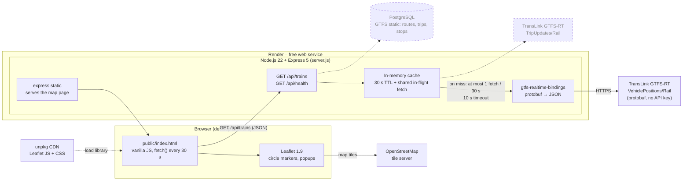
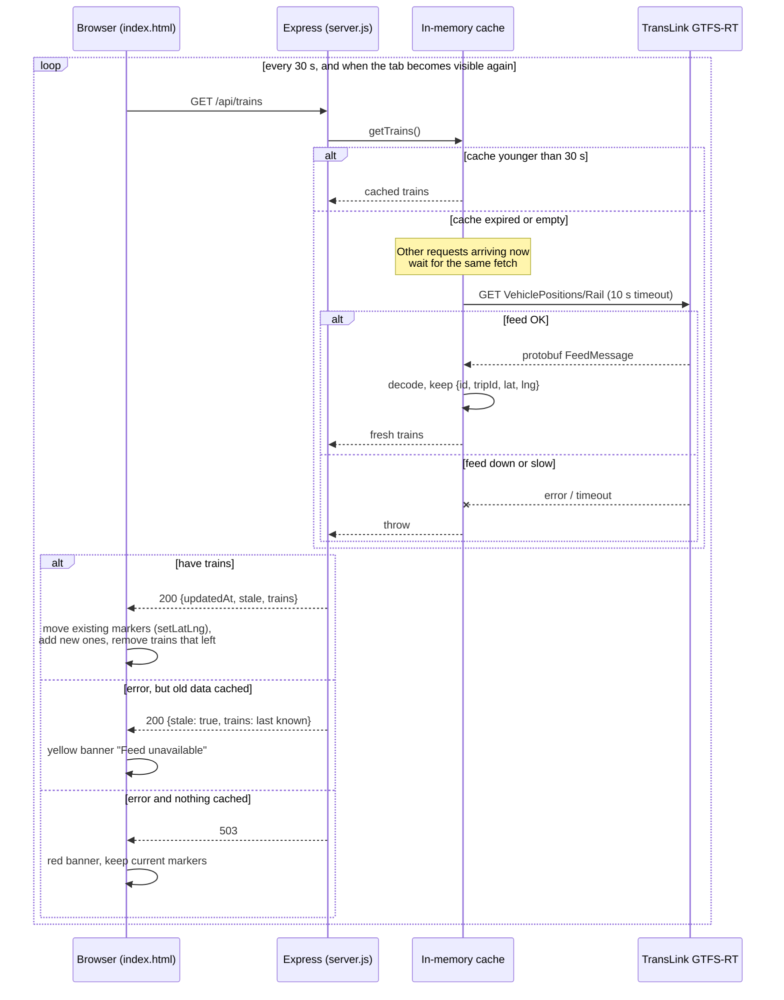
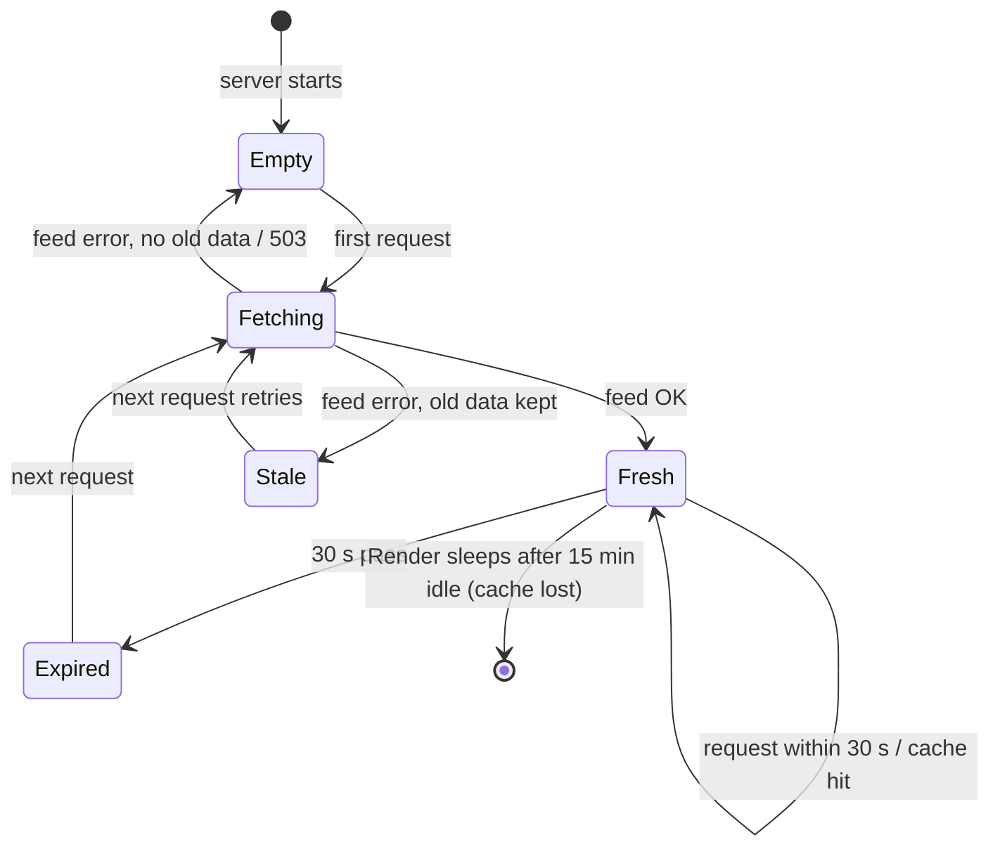

# Railway Live – Architecture

This document answers the planning questions from my 5 Oct design review, then shows the architecture, data flow and state diagrams.

## 0. Answers to the design questions

| Question | Answer |
|---|---|
| **Where is the app hosted?** | Render, free web service, auto-deployed from GitHub. See "Hosting options" below. |
| **How does data flow from TransLink to the page?** | Browser polls my Express server every 30 s → server serves from an in-memory cache, or fetches TransLink's GTFS-RT feed once, decodes the protobuf and returns small JSON. See diagrams 1 and 2. |
| **Built locally in Docker first?** | Not yet. I developed locally with `npm run dev` and deployed straight to Render. Dockerfile + docker compose (Node + Postgres) is planned for next week, before the database is added. |
| **Access requirements for the live data?** | None technically: no API key or account. The data is licensed CC BY 4.0, so TransLink must be credited (in the README and map). Use is subject to TransLink's open data terms. |
| **Rate limits?** | I didn't find a published rate limit. I designed as if there were one: the server calls TransLink at most once per 30 s however many users are online, with a 10 s timeout and stale-data fallback. |
| **Polling or WebSockets?** | Polling every 30 s, plus an immediate refresh when the tab becomes visible. The feed only updates about every 30 s, so push would not make data fresher. Next week I'll measure the real update interval and record the decision. |
| **Backend server, and a database or something like SQLite?** | Node.js 22 + Express 5. No database yet: live positions are only needed in memory. Next I need one for GTFS static data (route names, stops) and delay history. SQLite would be simplest locally, but Render's free disk is wiped on every deploy and restart, so the file would be lost; I'll use PostgreSQL (Neon free tier, same as Focus Tracker), run in Docker locally. |

### Hosting options considered

| Option | Fit for this app | Decision |
|---|---|---|
| **Render (free)** | Runs a normal long-lived Node server, so the in-memory cache works. Free, no card. Sleeps after 15 min idle (30–60 s cold start). | ✅ Chosen |
| Vercel | Easy Node deploys, but runs as serverless functions: memory isn't kept between requests, so the cache would need an external store. | Not now |
| Cloudflare Workers + KV | Fast and free, but a different runtime (not plain Express) and KV is eventually consistent. Good option to learn later. | Not now |
| Heroku | Supports Docker, no free tier; GitHub Student Pack credit covers it. | Backup if Render's sleeping becomes a problem |
| Oracle / GCP / Azure credits | Full VMs or managed services, but more setup and a credit card. | Not needed at this size |

## 1. Architecture diagram

Components, libraries, servers and APIs. Dashed boxes are planned for next week.

| Layer | Technology |
|---|---|
| Frontend | HTML, CSS, vanilla JavaScript, Leaflet, OpenStreetMap tiles |
| Server | Node.js 22, Express 5 (ES modules) |
| Data | TransLink GTFS-RT VehiclePositions (Rail), decoded with `gtfs-realtime-bindings` |
| Hosting | Render (free web service), GitHub for source and deploys |
| Planned | TripUpdates feed for delays, PostgreSQL for GTFS static data, Docker Compose for local runs |

## 2. Data flow: one map refresh

## 3. State diagram: the server cache

## 4. Design decisions

| Decision | Why |
|---|---|
| Server in front of TransLink | The browser gets small JSON instead of protobuf, and TransLink is called once per 30 s no matter how many users |
| 30 s cache, shared in-flight fetch | Matches the feed's update rate; concurrent cache misses make one upstream call |
| Polling every 30 s (not WebSockets) | The feed only changes about every 30 s, so push would not make data fresher; to be measured next week |
| Serve stale data instead of failing | The map stays useful when TransLink is down, with a clear warning |
| Same origin for page and API | No CORS setup needed |
