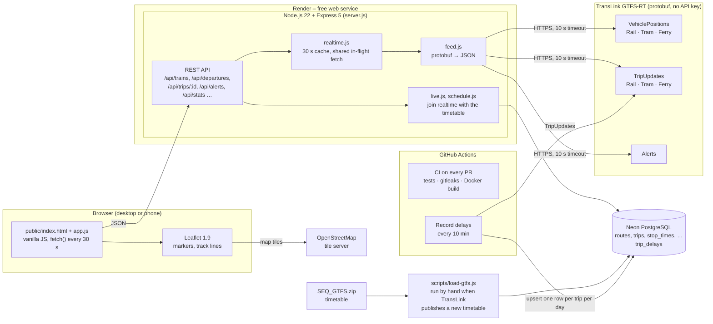
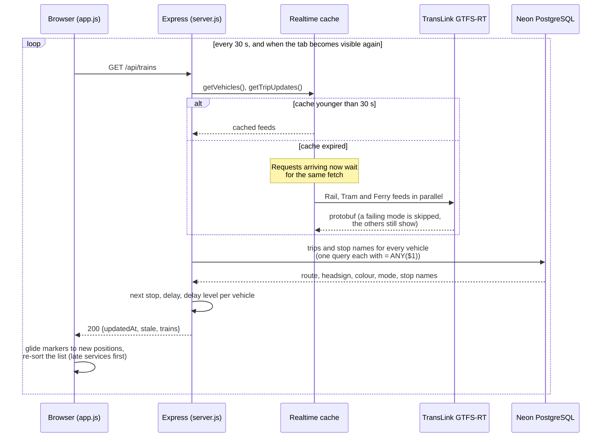
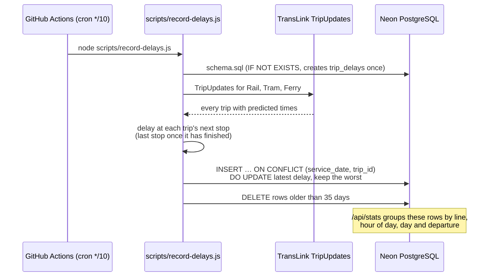
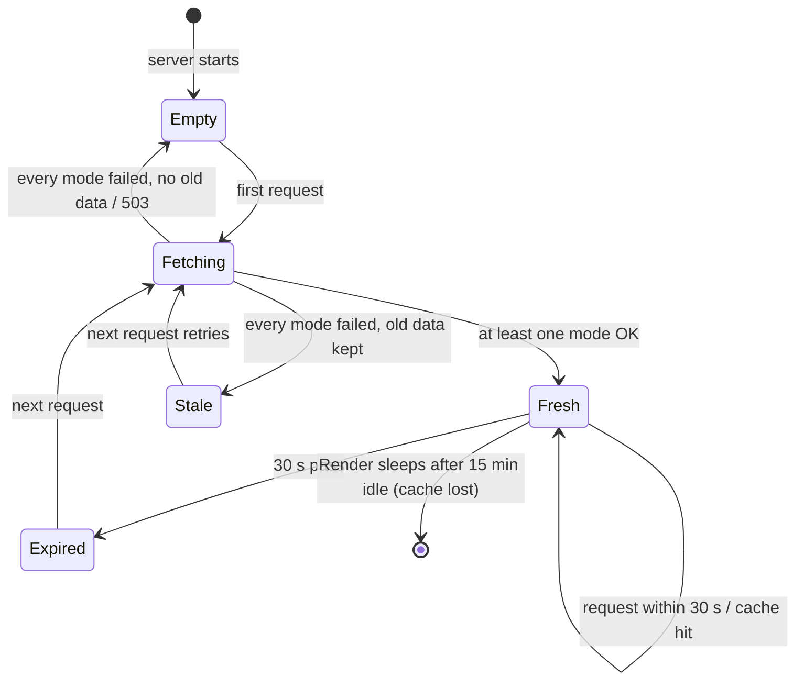

# Railway Live – Architecture

This document answers the planning questions from my 5 Oct design review (updated 8 Nov to match what is built), then shows the architecture, data flow and state diagrams.

## 0. Answers to the design questions

| Question | Answer |
|---|---|
| **Where is the app hosted?** | Render, free web service, auto-deployed from GitHub. See "Hosting options" below. |
| **How does data flow from TransLink to the page?** | Browser polls my Express server every 30 s → server serves from an in-memory cache, or fetches TransLink's GTFS-RT feed once, decodes the protobuf and returns small JSON. See diagrams 1 and 2. |
| **Built locally in Docker first?** | Yes, since week 2: `docker compose up` runs the app with its own Postgres. CI also builds the Docker image on every pull request. |
| **Access requirements for the live data?** | None technically: no API key or account. The data is licensed CC BY 4.0, so TransLink must be credited (in the README and map). Use is subject to TransLink's open data terms. |
| **Rate limits?** | I didn't find a published rate limit. I designed as if there were one: the server calls TransLink at most once per 30 s however many users are online, with a 10 s timeout and stale-data fallback. |
| **Polling or WebSockets?** | Polling every 30 s, plus an immediate refresh when the tab becomes visible. The feed itself only updates about every 30 s, so push would not make data fresher, and polling works through Render's free plan without long-lived connections. |
| **Backend server, and a database or something like SQLite?** | Node.js 22 + Express 5, with PostgreSQL on Neon. Postgres holds the train, tram and ferry timetable (about 320,000 stop times) and the delay history. SQLite was ruled out because Render's free disk is wiped on every deploy and restart. |

### Hosting options considered

| Option | Fit for this app | Decision |
|---|---|---|
| **Render (free)** | Runs a normal long-lived Node server, so the in-memory cache works. Free, no card. Sleeps after 15 min idle (30–60 s cold start). | ✅ Chosen |
| Vercel | Easy Node deploys, but runs as serverless functions: memory isn't kept between requests, so the cache would need an external store. | Not now |
| Cloudflare Workers + KV | Fast and free, but a different runtime (not plain Express) and KV is eventually consistent. Good option to learn later. | Not now |
| Heroku | Supports Docker, no free tier; GitHub Student Pack credit covers it. | Backup if Render's sleeping becomes a problem |
| Oracle / GCP / Azure credits | Full VMs or managed services, but more setup and a credit card. | Not needed at this size |

## 1. Architecture diagram

Components, libraries, servers and APIs, and how they connect.

| Layer | Technology |
|---|---|
| Frontend | HTML, CSS, vanilla JavaScript, Leaflet, OpenStreetMap tiles, self-hosted Nunito font |
| Server | Node.js 22, Express 5 (ES modules), helmet, express-rate-limit |
| Data | TransLink GTFS-RT (VehiclePositions, TripUpdates, Alerts) decoded with `gtfs-realtime-bindings`; GTFS static timetable |
| Database | PostgreSQL on Neon; `docker compose` Postgres locally |
| Jobs and CI | GitHub Actions: tests, gitleaks and a Docker build on every PR; the delay recorder every 10 minutes |
| Hosting | Render (free web service), auto-deployed from `main` |

## 2. Data flow: one map refresh

## 3. Data flow: recording delays

## 4. State diagram: the realtime cache

## 5. Design decisions

| Decision | Why |
|---|---|
| Server in front of TransLink | The browser gets small JSON instead of protobuf, and TransLink is called at most once per 30 s per feed however many people have the map open |
| Timetable in Postgres, realtime in memory | The timetable is large and changes rarely; live positions change every 30 s and are only needed for now |
| One query per refresh with `= ANY($1)` | About 60 vehicles need route and stop names; one round trip to Neon instead of 60 |
| Each mode fetched separately | If the ferry feed fails, trains and trams still show |
| Delay recording in GitHub Actions, not in the server | Render's free plan sleeps when nobody is using it, so a timer inside the server would leave gaps |
| One row per trip per day, updated in place | Keeps the history small enough for Neon's free plan; the latest delay is what the trip finished with |
| Turnbacks and relief points left out | GTFS marks them as no pick-up and no drop-off; showing them as "Next" would confuse passengers |
| Serve stale data instead of failing | The map stays useful when TransLink is down, with a clear warning |
| Brisbane time is fixed UTC+10 | Queensland has no daylight saving; service days can run past 24:00 |
